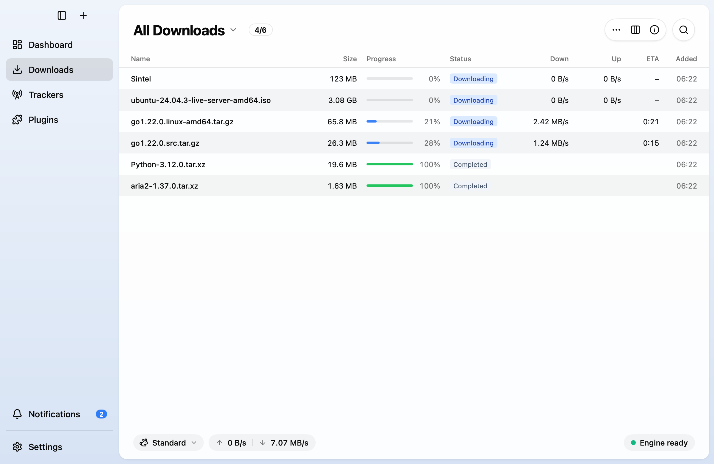
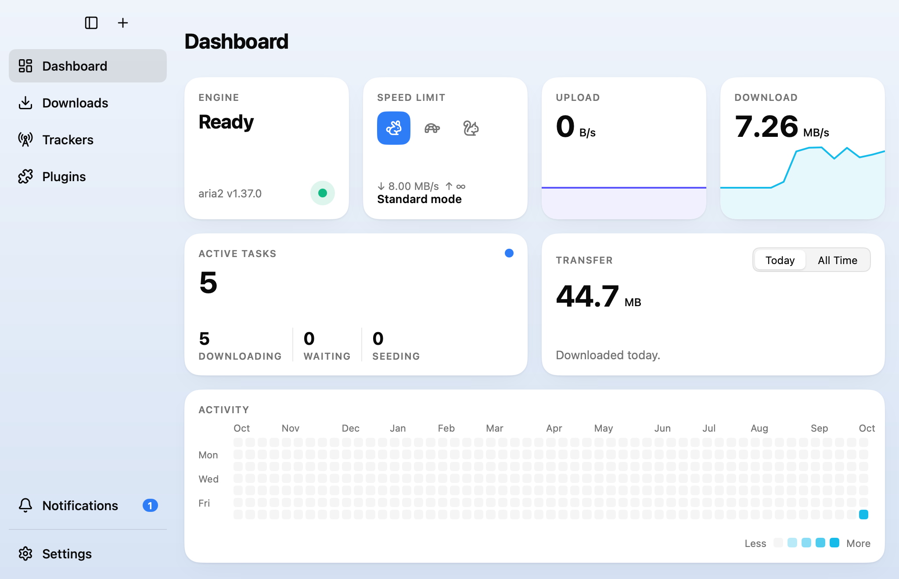
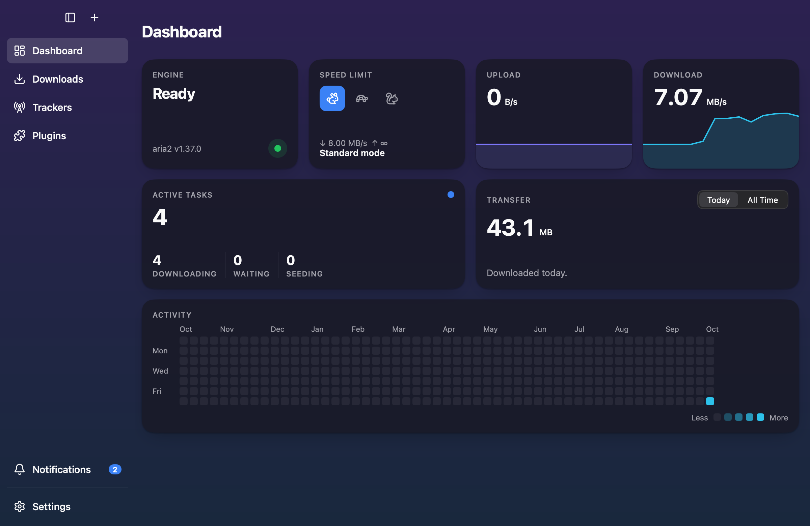
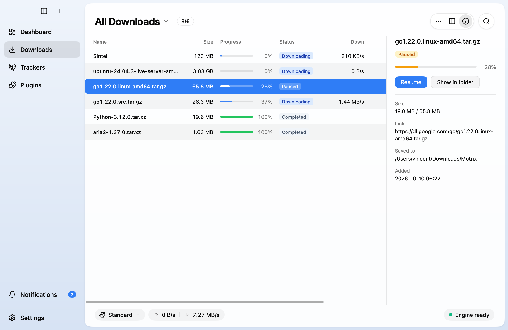
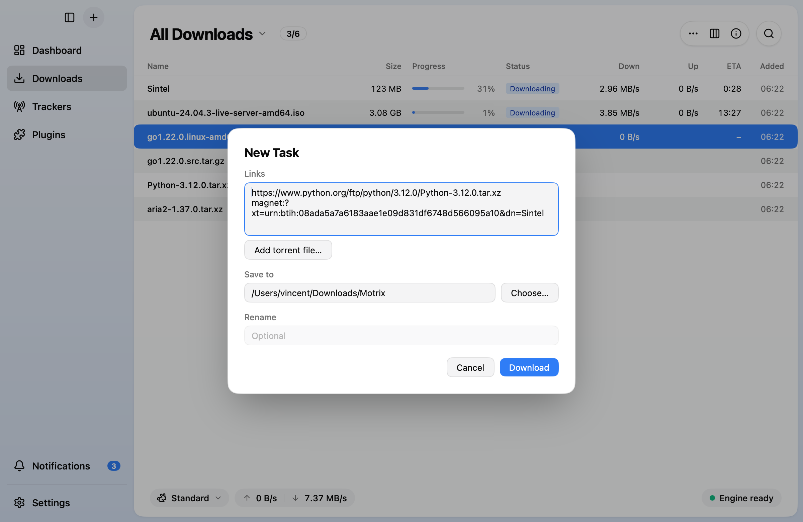
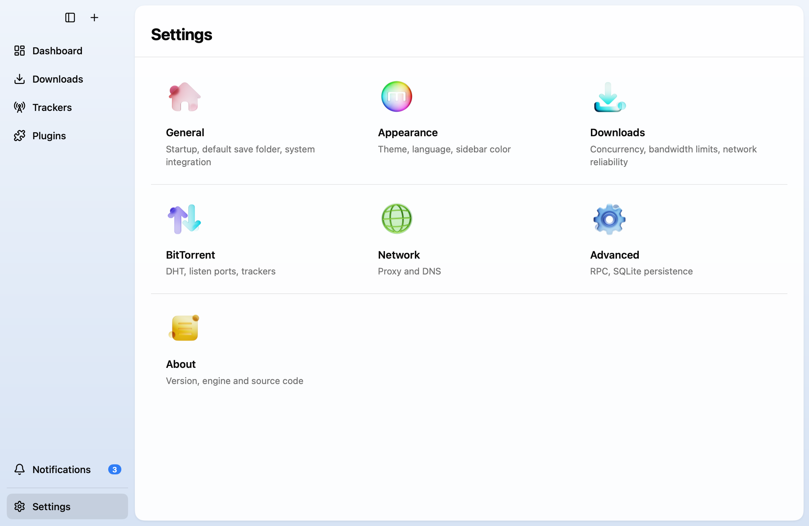
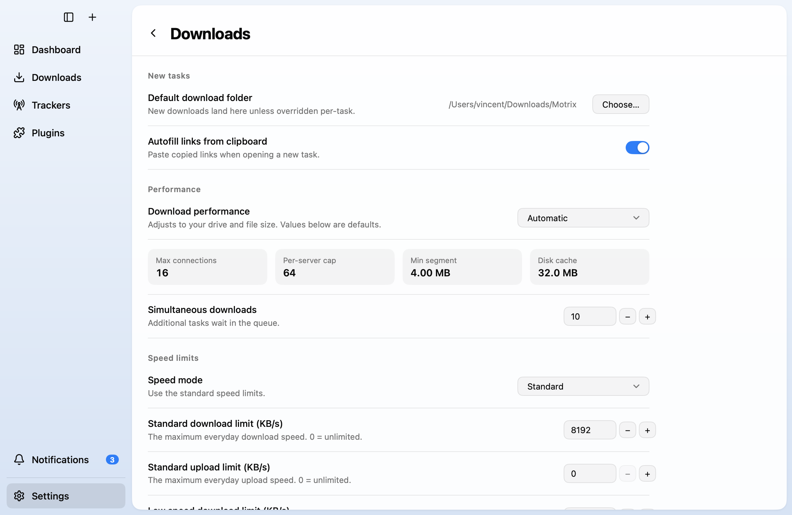
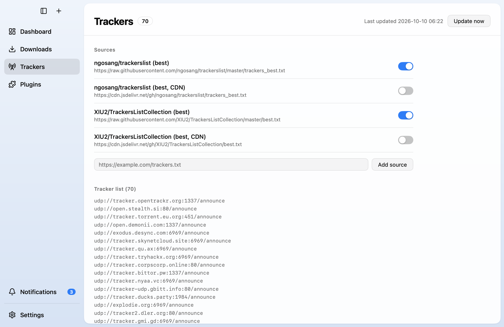
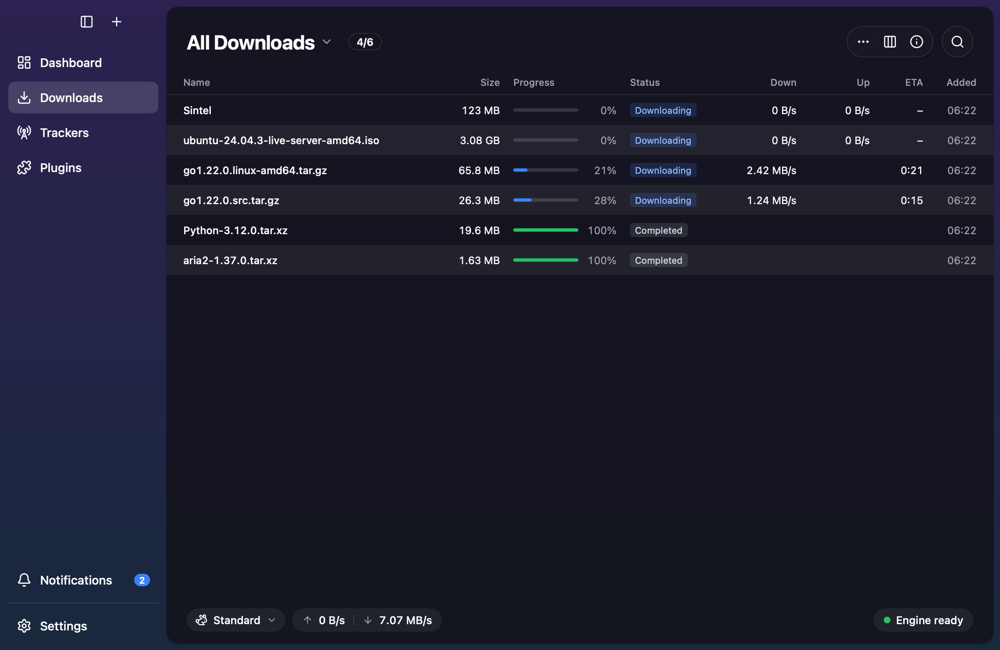

# Motrix (MyGo)

[Motrix](https://github.com/agalwood/Motrix) with its interface rewritten in Go
on [MyGo](https://github.com/egoist/mygo)'s native UI. There is no Electron and
no webview: one Go binary draws the window on the GPU and drives the same
`aria2c` build Motrix ships.



| | |
|---|---|
|  |  |
|  |  |
|  |  |
|  |  |

The screenshots are written by `TestLive` while it downloads real files, so
they show the app as it runs.

## Getting started

Requires Go 1.27 or later.

```sh
go run ./scripts/fetch-engine   # download aria2c for this machine (once)
go tool mygo dev                # run with live reload
go tool mygo build              # package the app into build/
```

`fetch-engine` downloads the `motrixapp/aria2` release pinned in
`scripts/fetch-engine/engine.lock.json`, which is Motrix's own lockfile, and
checks the archive and the binary against its SHA-256 digests. Pass `-all` to
fetch every platform before a cross-platform build.

## Features

- **Downloads**: HTTP, HTTPS, FTP, magnet links and `.torrent` files. The list
  sorts, filters by status, searches, hides columns, selects several tasks, and
  has a context menu and a details panel.
- **Dashboard**: engine state, speed mode, live upload and download speed,
  active tasks, transfer today and in total, and a year of activity.
- **Trackers**: tracker list sources that update on a schedule and are added to
  new BitTorrent tasks.
- **Notifications**: finished and failed downloads, in the app and as system
  notifications.
- **Settings**: the sections of Motrix, with its names, defaults and ranges.
- **Languages**: English and Simplified Chinese, using Motrix's own
  translations where it has the text.

## The engine

`engine/` runs `aria2c` 1.37.0-motrix.17, the fork Motrix uses, and talks to it
over JSON-RPC on the loopback. It follows Motrix's engine layer:

- **Arguments in layers.** The user's `aria2.conf` comes first, then what binds
  the engine to the app, then the settings, then the proxy, and last the
  product's invariants. aria2 honors the last occurrence of an option, so the
  invariants cannot be undone by anything before them.
- **`aria2.conf` template.** `resources/engine/aria2.conf` is Motrix's file. It
  is copied to the data directory on the first start, where it can be edited.
- **SQLite persistence.** Tasks and finished history survive restarts through
  the fork's `--enable-sqlite3-persistence`. With it turned off, the engine
  falls back to the `aria2.session` text file.
- **Live changes.** Options aria2 accepts at run time (speed limits,
  concurrency, connections, timeouts, proxy, trackers) are applied with
  `aria2.changeGlobalOption`. The rest (ports, DHT, disk cache, persistence)
  restart the process, and downloads continue afterwards.
- **Supervision.** If the RPC port is taken, the next free one is used and
  saved. A crashed engine is started again, and `--stop-with-process` makes
  aria2 exit when the app does.

### Settings

`settings.json` uses Motrix's keys. The engine settings and their defaults:

| Section | Settings |
|---|---|
| Performance | `performanceProfile` (auto, balanced, high, maximum, custom), `maxConcurrentDownloads` 10, `maxConnectionPerServer` 64, `split` 16, `minSplitSize` 4 MB, `diskCache` 32 MB |
| Connections and retries | `userAgent` `Motrix/2.0`, `connectTimeout` 30, `socketTimeout` 30, `maxTries` 5, `retryWait` 10, `lowestSpeedLimit` 0 |
| Disk and files | `fileAllocation` none, `remoteTime` false, `sessionSaveInterval` 15, `fileDeletionMode` trash |
| BitTorrent | `listenPort` 6881, `dhtListenPort` 6881, `dhtEnabled`, `btMaxPeers` 128, `btEnableLpd`, `seedRatio` 1, `seedTime` 60, `magnetResolveTimeout` 600 |
| Network | `dnsMode` (auto, system, engine), proxy (protocol, host, port, login, bypass list, scopes) |
| Advanced | `rpcPort` 16800, `rpcSecret`, `sqlite3Persistence`, `sqlite3DbPath`, `sqlite3HistoryLimit` -1 |
| Speed limits | standard and low-speed profiles, mode (standard, low speed, automatic), schedule, bandwidth reserve |

Speed limits are computed as Motrix computes them: the standard limits always
apply, low-speed mode takes the lower of the two profiles, and automatic mode
takes the lowest limit its active rules bring in.

## Differences from Motrix

- **Not ported**: plugins, the browser extension bridge, NAT port mapping and
  diagnostics, peer GeoIP, tracker probing and blacklists, media merging with
  FFmpeg, the tray icon, app updates, and choosing files of a torrent before it
  starts.
- **Proxy**: HTTP and HTTPS only. Motrix converts SOCKS5 through a local
  bridge, which is not here.
- **File names**: a download whose name is taken gets a number
  (`file.1.zip`), chosen before the task is added. A name the server sets
  through `Content-Disposition` is not checked this way.
- **Data directory**: `Motrix MyGo`, beside Motrix's own, so the two never
  share an aria2 session or database. Both default to RPC port 16800; whichever
  starts second moves to the next free port.

## Tests

```sh
go test ./...
```

The tests run the real `aria2c` against local HTTP servers, and the views
without a window. They are skipped where `fetch-engine` has not been run.

`TestLive` downloads real files from the internet (three HTTP downloads, an
Ubuntu torrent and a magnet link), pauses and resumes, checks speed limits,
removes tasks with their files, and rewrites the screenshots:

```sh
MOTRIX_LIVE=/tmp/motrix-live MOTRIX_SHOTS=docs/screenshots \
  go test -run TestLive -v -timeout 20m .
```

## Releasing

`.github/workflows/release.yml` runs when a tag is pushed. It checks the tag
against `version` in `mygo.json`, builds on two runners at once, and publishes
the release when both have uploaded:

| Runner | Output |
|---|---|
| macOS | `Motrix-<version>-macos-arm64.dmg` and `-macos-x64.dmg`, signed with the Developer ID, notarized and stapled; `aria2c` inside is signed with the hardened runtime |
| Ubuntu | `Motrix-<version>-windows-x64-setup.exe`, an NSIS installer, not code-signed |

The macOS job needs five repository secrets. Set them once from the `.p12`
certificate and a file of `KEY=value` lines, neither of which belongs in the
repository:

```sh
scripts/set-release-secrets.sh certificate.p12 credentials.txt
```

| Secret | |
|---|---|
| `MACOS_CERTIFICATE` | the "Developer ID Application" certificate with its key, as a base64 `.p12` |
| `MACOS_CERTIFICATE_PASSWORD` | the password of the `.p12` |
| `APPLE_ID`, `APPLE_TEAM_ID`, `APPLE_APP_PASSWORD` | the notary service's credentials: the Apple ID, its team, and an app-specific password |

The workflow imports them into a keychain that lives as long as the job, and
writes the signing identity it finds there into `mygo.json`, so builds on
other machines stay signed ad hoc. Then release a version:

```sh
# set "version" in mygo.json, commit, then
git tag v0.0.2
git push origin v0.0.2
```

## Platforms

- **macOS**: the traffic lights stay at the top left, with the sidebar and
  new-task buttons beside them.
- **Windows**: MyGo draws minimize, maximize and close at the top right. Page
  headers keep clear of them, and `Cmd` shortcuts are `Ctrl`. The Windows build
  compiles and packages from macOS and Linux, but has not been run on Windows.
- **Linux**: builds, and `fetch-engine` has its `aria2c`, but the release
  workflow does not publish it.

## Layout

| | |
|---|---|
| `main.go` | the window and the app's start |
| `app.go` | the state, the sidebar and the router of the pages |
| `downloads.go`, `addtask.go` | the task list and the dialog adding tasks |
| `dashboard.go`, `trackers_view.go`, `notifications.go` | the other pages |
| `settings.go`, `settings_view.go` | the settings and their pages |
| `theme.go`, `widgets.go`, `i18n.go` | colors, shared widgets and texts |
| `engine/` | the aria2 process, its arguments and its RPC |
| `scripts/fetch-engine/` | downloads and verifies `aria2c` |
| `scripts/set-release-secrets.sh`, `.github/workflows/` | the release workflow and its secrets |
| `resources/` | the app icon, `aria2.conf`, and `aria2c` per platform |
| `icons/`, `art/` | [Lucide](https://lucide.dev) icons (ISC) and Motrix's settings artwork (MIT) |

aria2 is licensed under the GPL-2.0-or-later and runs as a separate process.
